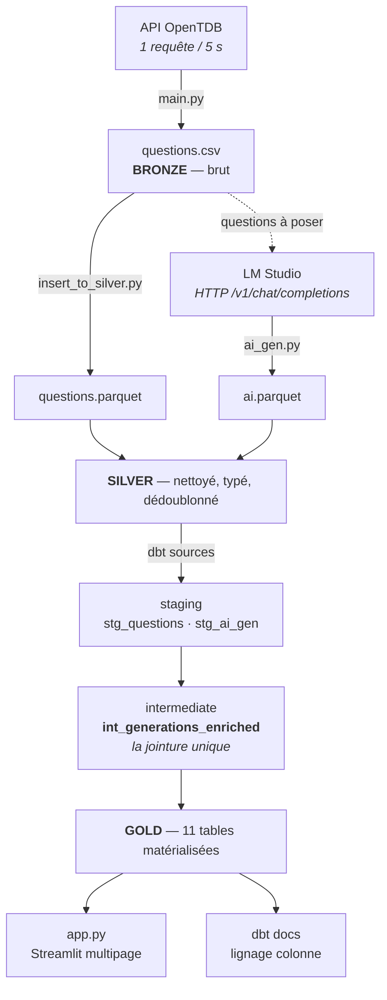

# Benchmark de LLM locaux sur OpenTDB

Pipeline BI complet — de l'ingestion d'une API publique jusqu'à un rapport
interactif — construit pour répondre à une question : **quel petit modèle de
langage répond le mieux à des questions de culture générale, et à quel coût ?**

Quatre modèles ont été évalués sur les 5 246 questions du corpus, soit
**20 984 générations**.

| | |
|---|---|
| **Sources** | [OpenTDB](https://opentdb.com) (questions) · [LM Studio](https://lmstudio.ai) (inférence locale) |
| **Stockage** | Parquet + DuckDB |
| **Transformation** | dbt-fusion 2.0 |
| **Restitution** | Streamlit + Altair |

---

## 1. Architecture

### Le flux



### Les quatre couches

**Bronze** — `questions.csv`. La réponse brute de l'API, décodée du HTML et
rien d'autre. On ne jette rien à ce stade : si une règle de nettoyage se révèle
fausse plus tard, la source est toujours là.

**Silver** — `questions.parquet` et `ai.parquet`. Typé, dédoublonné, avec des
clés stables. `question_id` est un SHA-1 tronqué de l'énoncé, ce qui rend le
pipeline **rejouable** : relancer une génération ne repose au modèle que les
questions qui n'ont pas déjà une réponse pour le couple
`(model_name, prompt_version)`.

**Gold** — 11 tables matérialisées dans `dbt/gold/gold.duckdb`. Le critère
d'admission est strict : *une table gold se lit sans jointure et sans
agrégation*. Si la personne qui l'ouvre doit encore écrire un `GROUP BY`, ce
n'est pas du gold, c'est du silver élargi. Une ligne de gold = une ligne du
tableau ou du graphique final.

**Restitution** — le dashboard Streamlit et la documentation dbt générée.

### Le DAG dbt

```
sources (silver)          staging                 intermediate              marts
─────────────────         ───────────────         ──────────────────        ──────────────────────────────
silver.questions   ──►    stg_questions   ──┐
                                            ├──► int_generations_enriched ──┬──► gold_format_compliance
silver.ai_gen      ──►    stg_ai_gen      ──┘         (la jointure)         ├──► gold_model_performance
                                                                           ├──► gold_prompt_performance
                                                                           ├──► gold_domain_performance
                                                                           ├──► gold_category_performance
                                                                           ├──► gold_difficulty_performance
                                                                           ├──► gold_domain_difficulty_matrix
                                                                           ├──► gold_category_difficulty_matrix
                                                                           ├──► gold_model_cost
                                                                           └──► gold_failure_review
                                                                                     └──► gold_failure_sample
```

**Un seul nœud fait la jointure.** C'est la décision structurante du projet.
Toutes les tables gold agrègent `int_generations_enriched` et rien d'autre, donc
**deux tables gold ne peuvent pas se contredire** : elles regardent les mêmes
lignes. Si chaque mart faisait sa propre jointure, deux d'entre eux pourraient
la faire légèrement différemment et afficher deux totaux différents pour la
même chose.

### Arborescence

```
BI_TP/
├── main.py                      Bronze  — ingestion OpenTDB (rate limit 5 s)
├── ai_gen.py                    Client LM Studio : prompt, schéma JSON, parsing
├── insert_to_silver.py          Silver  — CSV → parquet, rejouable, parallélisable
├── questions.csv                Bronze
├── questions.parquet            Silver  — 5 246 questions
├── ai.parquet                   Silver  — générations des modèles
│
├── dbt/
│   ├── dbt_project.yml
│   ├── profiles.yml             Cible DuckDB : gold/gold.duckdb
│   ├── bootstrap_silver.sh      Enregistre les parquet comme vues silver
│   ├── macros/
│   │   └── metriques_accuracy.sql        Bloc de métriques partagé
│   ├── models/
│   │   ├── sources.yml
│   │   ├── staging/             stg_questions · stg_ai_gen
│   │   ├── intermediate/        int_generations_enriched  ← la jointure unique
│   │   └── marts/               11 tables gold + schema.yml
│   ├── tests/
│   │   └── assert_generations_unique_grain.sql
│   └── gold/gold.duckdb         ⚙ généré — base livrable, ouvrable depuis tout outil BI
│
├── app.py                       Rapport interactif — entrypoint multipage
├── lib/                         Connexion DuckDB, palettes, fabriques de graphiques
├── views/                       Une page par question de GOLD.md §5
├── .streamlit/config.toml       Thème aligné sur la palette validée
├── GOLD.md                      Document de conception de la couche gold
├── README.md
│
├── requirements.txt             Dépendances épinglées
├── .gitignore
│
└── gold.sql                     ⚠ hérité — remplacé par dbt (voir ci-dessous)
```

Les fichiers marqués ⚙ sont **générés** et absents du dépôt : `gold.duckdb` se
reconstruit en une seconde depuis les parquet versionnés. Sont également
ignorés `dbt/target/`, `dbt/logs/`, `db.duckdb` et `.venv/` — 680 Mo d'artefacts
qui n'ont rien à faire dans un dépôt. Les trois fichiers de données, eux, sont
versionnés : `ai.parquet` représente 21 000 appels LLM et environ 16 h de
calcul, le dépôt serait inutilisable sans lui.

### Les deux fichiers hérités

[gold.sql](gold.sql) est la **première implémentation** de la couche gold : un
script DuckDB autonome, décrit dans [GOLD.md](GOLD.md), qui produisait ses
tables dans `db.duckdb`.

Il a été remplacé par le projet dbt, qui apporte ce qu'un script seul ne peut
pas offrir : un DAG explicite, des tests qui cassent le build, du lignage au
niveau colonne, et une documentation générée. Les deux fichiers sont conservés
parce que `GOLD.md` — le document de conception dont tout le reste découle — s'y
réfère, et parce qu'ils permettent de comparer les deux approches.

**La source de vérité est `dbt/gold/gold.duckdb`.** `db.duckdb` n'est plus mis à
jour.

---

## 2. Méthodologie

Trois décisions portent tout le reste. Ce sont elles qui distinguent un
benchmark exploitable d'un tableau de pourcentages.

### Le lift, pas l'accuracy

Un QCM à quatre options se devine à 25 %, une question vrai/faux à 50 %. Une
accuracy brute mélange donc la compétence du modèle et la facilité du format.

`int_generations_enriched` calcule `n_choices` — le nombre d'options
réellement présentées, en miroir de `build_choices()` dans `ai_gen.py` — d'où
une espérance au hasard de `1 / n_choices`, puis :

```
lift = accuracy − espérance au hasard
```

L'espérance moyenne du corpus vaut **28,7 %**. C'est ce qui transforme
« `gemma-3-270m` : 28,5 % » — qui ressemble à un résultat — en **« lift de
−0,3 point : ce modèle ne répond pas, il tire au sort »**. Aucun pourcentage
brut ne montre ça.

### Le grain, tenu et testé

> une ligne = une réponse d'un modèle à une question avec un prompt donné

Cette phrase est le contrat de la couche intermédiaire. Si elle se rompt,
chaque `count(*)` et chaque `avg()` en aval sont faux **sans lever la moindre
erreur** — la classe de bug la plus pénible à diagnostiquer sur un chiffre
agrégé.

Elle a effectivement été rompue : un benchmark de concurrence avait reposé 4
questions à `gemma-3-270m`, une fois à `concurrency=1` et une fois à
`concurrency=4`. Un `QUALIFY` la rétablit, et
[assert_generations_unique_grain.sql](dbt/tests/assert_generations_unique_grain.sql)
casse le build si un doublon réapparaît.

### Ne jamais afficher un chiffre sans son effectif

Le corpus est très déséquilibré : `Entertainment` pèse 2 775 questions sur
5 246, `Celebrities` en pèse 53. Deux gardes en découlent.

`accuracy_micro` (pondérée par le corpus) et `accuracy_macro` (moyenne non
pondérée des taux par catégorie) sont publiées **côte à côte** : l'écart entre
les deux mesure la représentativité du jeu de données.

Et toute cellule sous 30 questions porte `is_reliable = false`. Une case à
n=6 affichée dans la même palette qu'une case à n=300 produit une conclusion
inventée — le dashboard les estompe et imprime le `n` dans chaque case.

### Séparer l'échec de format de l'échec de connaissance

`ai_answer_clean` est *nullable* en silver plutôt que forcé à `false`. Une
réponse illisible n'est pas une mauvaise réponse : c'est un problème de
format, qui appelle une correction différente. `gold_format_compliance` se lit
donc **en premier** — elle conditionne la validité de tout le reste.

### Ordre de lecture

Les tables gold ne sont pas parallèles, elles forment une chaîne. Le dashboard
suit cet ordre.

| # | Table | Question à laquelle elle répond |
|---|---|---|
| 1 | `gold_format_compliance` | Mes chiffres sont-ils exploitables ? |
| 2 | `gold_model_performance` | Qui gagne, et bat-on le hasard ? |
| 3 | `gold_domain_performance` · `gold_difficulty_performance` | Sur quels thèmes, à quel niveau ? |
| 4 | `gold_*_difficulty_matrix` | Où ça casse précisément ? |
| 5 | `gold_model_cost` | Est-ce que ça vaut le temps machine ? |
| 6 | `gold_failure_review` · `gold_failure_sample` | À quoi ressemble un échec ? |

---

## 3. Setup complet

### Prérequis

- Python 3.12
- [DuckDB CLI](https://duckdb.org/docs/installation/) (`duckdb` dans le `PATH`)
- [dbt-fusion 2.0](https://docs.getdbt.com/) (`dbt` dans le `PATH`)
- [LM Studio](https://lmstudio.ai) avec son serveur local, **uniquement pour
  régénérer les données** — le dépôt contient déjà les parquet

### Installation

```bash
python3.12 -m venv .venv
.venv/bin/pip install -r requirements.txt
```

### Chemin rapide : exploiter les données existantes

Les parquet sont versionnés, il n'y a donc rien à régénérer.

```bash
cd dbt
./bootstrap_silver.sh                               # enregistre les vues silver
dbt build --static-analysis strict                  # 14 modèles + 5 tests
cd .. && .venv/bin/streamlit run app.py             # http://localhost:8501
```

`bootstrap_silver.sh` crée dans `gold.duckdb` deux vues `silver.*` pointant sur
les parquet en **chemins absolus**. C'est nécessaire : DuckDB résout les chemins
relatifs contre le répertoire courant du processus, pas contre l'emplacement du
fichier `.duckdb`, donc une base ouverte depuis un autre dossier échouerait.

### Chemin complet : tout régénérer

```bash
# 1. Bronze — ingestion OpenTDB (long : 1 requête toutes les 5 s)
.venv/bin/python main.py

# 2. Silver — interroger un modèle sur les questions restantes
.venv/bin/python insert_to_silver.py --model "lmstudio-community/llama-3.2-3b-instruct"
```

Options de `insert_to_silver.py` :

| Option | Effet |
|---|---|
| `--model` | Modèle LM Studio à interroger |
| `--prompt-version` | Clé dans `PROMPT_BUILDERS` (défaut `v1`) |
| `--limit N` | Ne poser que les N premières questions restantes |
| `--workers N` | Questions en parallèle. **`1` pour mesurer des latences propres** |

Le script est rejouable : il ne repose que les questions sans génération pour
le couple `(model, prompt_version)`.

L'adresse du serveur LM Studio vient de l'environnement, et vaut
`http://localhost:1234` par défaut — l'installation standard. Pour un serveur
sur une autre machine :

```bash
export LMSTUDIO_URL="http://192.168.1.42:1234"
```

> ⚠️ `ai.parquet` est réécrit toutes les 20 générations. **Rebuilder gold après
> la fin d'un run**, sinon les tables matérialisent un instantané partiel.

### Documentation dbt

```bash
cd dbt
dbt compile --write-index --static-analysis strict   # indispensable pour le lignage
dbt docs generate --no-compile
dbt docs serve
```

`dbt docs generate` seul n'accepte pas `--static-analysis` : sans l'étape
`compile`, l'index ne contient pas `node_columns` et le serveur renvoie une
erreur de catalogue.

---

## 4. Le dashboard

`app.py` lit les tables gold matérialisées — aucune dépendance aux
chemins parquet. Cinq sections suivant l'ordre de lecture ci-dessus.

**Interactif** — cliquer une barre du classement pilote le modèle analysé dans
toutes les sections suivantes. Survol, infobulles, et chaque graphique double
d'une vue tabulaire dépliable, pour que l'identité ne repose jamais sur la
seule couleur.

**Graphiques** — chaque forme suit le métier de la donnée : barre divergente
pour le lift (au-dessus / en-dessous d'une référence), heatmap divergente
ancrée sur zéro pour la matrice, nuage de points en échelle log avec emphase
pour le coût.

**Palette** — validée par script contre la surface claire, avec vérification
des écarts en vision déficiente. Le thème est volontairement fixé en clair
dans [.streamlit/config.toml](.streamlit/config.toml) : un thème sombre
demanderait sa propre validation.

---

## 5. Résultats

### Classement (5 246 questions communes, prompt v1)

| Modèle | Accuracy | Macro | Lift | Conformité | Latence p50 |
|---|---|---|---|---|---|
| `llama-3.2-3b-instruct` | **63,5 %** | 65,6 % | **+34,8 pts** | 100 % | 0,42 s |
| `ministral-3-3b` | 60,9 % | 64,0 % | +32,2 pts | 99,8 % | 3,87 s |
| `lfm2.5-1.2b` | 48,3 % | 50,5 % | +19,6 pts | 100 % | 1,65 s |
| `gemma-3-270m` | 28,5 % | 29,5 % | **−0,3 pt** | 99,8 % | 6,17 s |

Espérance au hasard : **28,7 %**.

### Coût

| Modèle | Durée totale | s / bonne réponse | Questions / min |
|---|---|---|---|
| `llama-3.2-3b-instruct` | 90 min | **1,62 s** | 58,2 |
| `lfm2.5-1.2b` | 144 min | 3,41 s | 36,5 |
| `ministral-3-3b` | 252 min | 4,74 s | 20,8 |
| `gemma-3-270m` | 554 min | 22,26 s | 9,5 |

`llama-3.2-3b-instruct` gagne sur **les deux axes** : le plus précis *et* le
moins cher. Le compromis qualité/vitesse qu'on attendait n'existe pas ici.

### Trois enseignements

**Un modèle à 270 M de paramètres ne répond pas.** Son lift négatif le classe
au niveau du tirage au sort. Publié en accuracy brute, ses 28,5 % auraient
ressemblé à un résultat faible mais réel.

**Le label `difficulty` d'OpenTDB est informatif** — ce qui n'allait pas de
soi. Pour `llama-3.2-3b-instruct` : 70,9 % en *easy*, 61,9 % en *medium*,
55,1 % en *hard*, et le lift décroît aussi (+40,9 / +33,5 / +27,9 points). La
monotonie tient sur les deux mesures. Mais pas pour tous : `gemma-3-270m` est
plat, ce qui est cohérent avec un modèle qui devine.

**Le corpus déforme le classement.** `accuracy_macro` dépasse `accuracy_micro`
de ~2 points sur tous les modèles, parce qu'`Entertainment` — 22 % du corpus —
est l'avant-dernier domaine en réussite. L'accuracy brute est donc en partie
un test de culture jeux vidéo.

---

## 6. Limites connues

**Un seul prompt.** Seul `v1` existe, donc `gold_prompt_performance` sort un
delta mécaniquement nul. La table et la clé de dédoublonnage sont prêtes ; il
ne manque que la donnée.

**Pas d'axe temps.** Silver n'a pas de `run_id`, seulement `generated_at`. On
compare des modèles entre eux, pas l'évolution d'un même modèle dans le temps.

**Pas de calibration.** Aucun logprob n'est stocké : impossible de savoir si le
modèle hésitait.

**Coût approximatif.** `response_time` est un temps mur incluant la latence
réseau — c'est le coût observé du service, pas le coût GPU. Le bloc `usage` de
l'API LM Studio (`prompt_tokens`, `completion_tokens`) n'est pas persisté ; le
stocker donnerait des métriques bien plus solides.

**Biais de position hors d'atteinte.** Le mélange des choix est *seedé* sur
`question_id` donc reproductible, mais il utilise le `random` de Python et
n'est pas rejouable en SQL. Toute analyse de biais de lettre exigerait de
matérialiser `correct_letter` et `answer_letter` en silver.

**Un run écarté.** `google/gemma-4-e4b` s'est arrêté à 25 questions sur 5 246.
Un échantillon à 0,5 % du corpus ne soutient aucune lecture de gold : il est
exclu dans `int_generations_enriched`, donc partout en aval. La ligne est
commentée et se retire si le run est refait.
